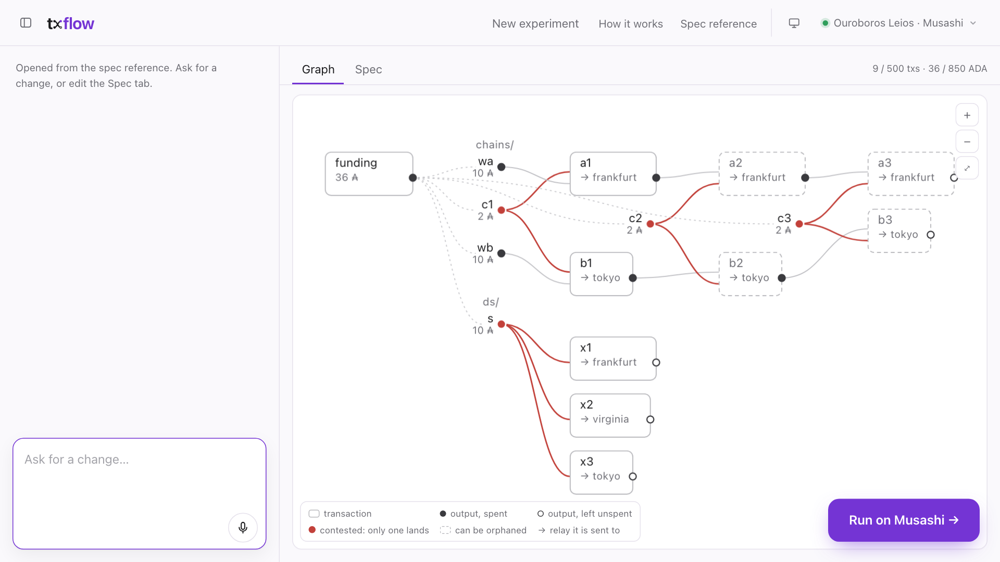

# txflow

Describe a Cardano transaction flow, see its UTxO graph, and run it on the
Leios Musashi test network.

<p align="center">
  <strong><a href="https://txflow.fun">txflow.fun</a></strong> · <a href="https://txflow.fun/spec.html">Spec reference</a>
</p>

<p align="center">
  <picture>
    <source media="(prefers-color-scheme: dark)" srcset="docs/images/editor-dark.png">
    
  </picture>
</p>

An experiment is a short YAML spec: which transaction spends which output, where
transactions deliberately conflict, and which relay gets each one when. It has
no transaction ids, so the same spec reruns on the next node build or another
network.

## What is here

- **The spec**: its grammar, the pattern catalogue, expansion into a UTxO graph
  and the checks (`crates/txflow-core`), versioned as a JSON Schema
  (`schema/`).
- **The CLI** (`crates/txflow`): check a spec, expand it, and materialise it
  offline into signed Cardano transactions.
- **The browser build** of the check (`crates/txflow-wasm`).
- **The relay bridge** (`scripts/relay-bridge.mjs`, `deploy/`): a small HTTP
  server beside a node that submits signed transactions through `cardano-cli`
  and serves the node's own mempool and block events from its trace.
- **The network file** for the Leios Musashi test network (`networks/`) and
  example specs (`examples/`).

[txflow.fun](https://txflow.fun) is one site built on these: it turns plain
words into a spec, draws its graph, and runs it on Musashi.

## A spec

```yaml
version: 0
experiment: relay-race
seed: 1
wallets:
  alice: {}
patterns:
  - id: chains
    use: conflicting_chains        # two chains, every step contested
    with: { length: 3, conflict: per_step }
schedule:
  releases:
    - { select: { label: side-a }, target: frankfurt }
    - { select: { label: side-b }, target: tokyo }
```

Patterns (`chain`, `conflict_set`, `fan_out`, `branch_merge`, …) are the
building blocks. Repeat them with `count`, join them with your own
transactions, and time each release. Tag transactions with your own `metadata`,
or a `color` that `mempool-monitor` paints them in
([example](examples/tagged-double-spend.yaml)). Every field is in the
[spec reference](https://txflow.fun/spec.html); the JSON Schema is at
[txflow.fun/schema/v0.json](https://txflow.fun/schema/v0.json) (source in
[`core/schema/v0/`](schema/v0/)).

## The CLI

```sh
cargo run --manifest-path core/Cargo.toml -p txflow -- check examples/relay-race.yaml --network networks/musashi.json
cargo run --manifest-path core/Cargo.toml -p txflow -- expand examples/relay-race.yaml       # the transaction graph
cargo run --manifest-path core/Cargo.toml -p txflow -- materialise examples/conflicting-chains.yaml \
  --context examples/demo-context.yaml -o manifest.json      # signed txs, offline
cargo run --manifest-path core/Cargo.toml -p txflow -- schema                                # the JSON Schema
```

Builds for Linux and macOS are on the [releases page](../../releases), next to
each spec version's schema. The demo context uses a publicly known dummy key and
a fake funding UTxO, so its transactions are well formed but no node will
accept them.

## Repository

| Path | What |
|---|---|
| `crates/txflow-core` | The spec, pattern catalogue, expansion and checks. No network or crypto, so it also runs in the browser as WebAssembly. |
| `crates/txflow` | Offline materialise (Pallas) and the `txflow` CLI. |
| `crates/txflow-wasm` | Browser bindings: check a spec and get the JSON Schema. |
| `schema/`, `examples/`, `networks/`, `limits.json` | The generated schema, example specs, the Musashi relays and an example limits file. |
| `scripts/`, `deploy/`, `test/` | The relay bridge, its setup on a relay or a gateway, and its tests. |

- [Working on txflow](docs/development.md): the code, tests and changing the
  grammar.
- [The relay bridge](docs/bridge.md): running it on a relay or a gateway.
- Design: [spec](specs/spec.md), [data model](specs/data-model.md),
  [decisions](specs/research.md).

## License

[Apache 2.0](LICENSE)
